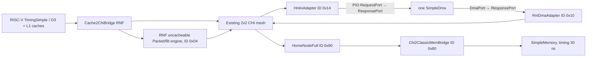

# HNI—DMA—RNI software timing baseline

This is a finite-resource functional/timing baseline on this repository's
custom CHI mesh. It is not upstream Ruby CHI and is not RTL cycle accurate.
Repository audit and reused interfaces: [gate0.md](gate0.md).
Executed matrix, measured results, file list and validation evidence:
[results.md](results.md).

## Build and run

From `/nfs/home/majunhong/project/chiron/XS-DSU-GEM5`:

```sh
# Builds gem5 + guest and runs the actual 64 B CPU closure.
python3 tests/gem5/dma/run.py --smoke

# Builds, runs HNF unit tests, all CPU tests, three benchmarks, timing
# backpressure tests, and negative path tests, including both 1 MiB cases.
python3 tests/gem5/dma/run.py
```

Standalone build and simulation:

```sh
scons build/RISCV/gem5.opt --ignore-style --linker=gold -j32
make -C tests/test-progs/simple_dma
build/RISCV/gem5.opt --outdir=results/dma-baseline/custom \
  configs/example/chi_dma.py --mode dma_copy --length 4096 \
  --chunk-bytes 256 --parallel-chunks 4
```

The available guest compiler is `riscv64-linux-gnu-gcc`; the Makefile accepts
`CROSS_COMPILE`. The workload is RV64GC static C, actually executed by the
repository's RiscvTimingSimpleCPU by default, with ordinary 16 KiB instruction/
data caches. `--cpu o3` selects Xiangshan O3 and has a separate 64 B acceptance
case. The RISC-V decoder now accepts aligned TimingSimpleCPU fetch words as
well as O3's instruction-address words, including 32-bit instructions spanning
two aligned words. The guest explicitly executes compressed instructions in
both halves and a straddling 32-bit instruction before any DMA access.
RISC-V SE page translation now
preserves `Process.map(cacheable=False)`. SE delegates the simulated CYCLE
and INSTRET counters; the host-based TIME register is never used.

`--mode mmio --iterations 64` reads SCRATCH and then writes/reads back it.
`--mode mixed --length 64 --iterations 16` initializes/validates once, then
continuously clears/starts/polls jobs without initialization gaps inside the
measured interval. `--mode regression` runs every required length in one CPU
process. `--mode errors` includes overlap, overflow, address rejection, zero
length, low/high halves, busy START, configuration snapshots and CLEAR while
BUSY. `--stalls` injects real gem5 timing retries on the PIO and DMA paths.
`--rni-entries`, `--chi-outstanding` and `--hnf-entries` set actual resource
limits. The CPU factory requires at least 8 HNF entries: the existing CPU cache
path stalled during startup with pools of 2/4. The CPU-free directed test uses
2 HNF entries; the CPU retry test uses 8 HNF entries and 2 RNI entries.
`--poll-limit` is a bounded guest polling limit. `--reverse-data` is
a test hook reversing valid HNF CompData beats only for the DMA RNI requester,
leaving the existing CPU RNF's instruction fetch protocol unchanged.
The runner accepts `--jobs` (default 2), `--timeout` (per-case host execution
limit, default 3600 s) and `--cases REGEX` for focused repairs. The two large
CPU initialization/checking workloads can take substantial host time;
`--smoke` and the default standalone 64 B workload stay short. Host execution
limits never enter simulated performance calculations.
Focused `--cases` runs replace their selected results and preserve other
records already present in the output directory. Full runs reset the matrix.

## Topology and address ownership



Both request paths use the **same** router objects. Responses reverse the
corresponding paths. `build_dma_path()` in `configs/example/chi_dma.py` owns
construction, NodeIDs and wiring. RNF uses its established uncached Packet
output to the RNF-side flit engine, replacing its old timing connection to
the classic bus. The CPU can reach the device only through RNF, mesh and HNI.
Only SimpleDma's DMA port reaches the RNI engine.

| Region | Guest VA | Physical/device address | Attributes |
|---|---:|---:|---|
| RAM | normal SE mapping | `[0, 0x20000000)` | ordinary caches enabled |
| MMIO | `0x40000000` | `0x40000000`, 4 KiB | uncacheable, strictly ordered |
| Buffer aperture | `0x50000000` | `0x10000000`, 4 MiB | uncacheable, strictly ordered |
| Destination base | `0x50200000` | `0x10200000` | within the same aperture |

The guest uses the explicit mapping above to publish **physical DMA
addresses**, not arbitrary userspace pointers. There is no IOMMU. Buffers are
owned exclusively by the device between START and terminal STATUS; no
cacheable aliases or simultaneous CPU buffer accesses are supported. The
small SE workload's ordinary allocations are below this dedicated aperture;
a future allocator/platform must reserve it formally before general workloads
are allowed. Fences publish initialization/configuration and order result
checks. CPU initialization and each byte of source/destination/guard checking
use actual instructions and timing requests. The guest groups byte checks
into 64-bit loads and compares all eight individual bytes.

The optional `loader_side` on the RNF uncacheable engine is exclusively for
SE ELF/stack initialization and syscall functional proxies. It rejects every
functional access intersecting MMIO or DMA buffers. RNI has no connected
loader port. Neither device payload nor MMIO can use this route, and atomic
requests to adapters are rejected. Source initialization is never supplied
by configuration or host copying.

## Stable device ABI

`src/dev/simple_dma_regs.h` is shared by C++ and guest C.

| Offset | Register | Width | Access |
|---:|---|---:|---|
| 0x00 | SRC_ADDR | 64 | RW |
| 0x08 | DST_ADDR | 64 | RW |
| 0x10 | LENGTH | 64 | RW |
| 0x18 | CONTROL | 32 | START=1, CLEAR_STATUS=2 |
| 0x1c | STATUS | 32 | RO: BUSY=1, DONE=2, ERROR=4 |
| 0x20 | BYTES_DONE | 64 | RO |
| 0x28 | ERROR_CODE | 32 | RO |
| 0x30 | SCRATCH | 64 | RW, no side effects |

All registers are little endian. A 64-bit register permits one aligned 8-byte
access or aligned 4-byte accesses to its low/high halves. The three 32-bit
registers permit only aligned 4-byte accesses. Other widths, gaps, RO writes,
masked PIO writes and out-of-window accesses return BadAddressError; illegal
device accesses also set ERROR/ACCESS. Adapters do not enlarge a PIO access,
implicitly read a device register, or perform PIO read-modify-write.

START snapshots SRC/DST/LENGTH. Configuration writes while BUSY affect the
next job only. Busy START sets the sticky BUSY error (code 1), preserves the
running job and does not execute again. CLEAR while BUSY is ignored, including
when combined with START; it does not cancel events or hide errors. An accepted
new idle START resets old status. CLEAR while idle clears status/error/bytes.
A rejected busy START can therefore finish with DONE|ERROR and BYTES_DONE equal
to the original job length. Unsupported CONTROL bits set ACCESS without START.

Zero length completes immediately without payload. Nonzero overlapping source
and destination ranges are rejected (memcpy only). Error codes: BUSY=1,
OVERFLOW=2, OVERLAP=3, ADDRESS=4, ACCESS=5, DMA_RESPONSE=6. Address and arithmetic
validation happen before issue. On DMA error, stop issuing new chunks, await
all already accepted callbacks, then clear BUSY with ERROR and without DONE.
BYTES_DONE counts successful completed chunks; on an error it may conservatively
under-report partially completed chunks. No partially failed job is advertised
as a successful copy. Interrupts and cancellation are not implemented.

Each chunk has permanently owned storage and separate read/write events.
`chunk_bytes` and `parallel_chunks` change behavior; reads complete before that
chunk's writes begin. DmaPort may split one action into many Packets. DONE waits
for all write Packet responses and the final chunk callbacks.

## Protocol subset and completion

Reuse `RawReq/RawRsp/RawDat`, `ChiCommonPort`, router credit queues, NodeID and
opcode decoders. This fork uses **byte count** RawReq.size, 64-byte lines,
32-byte DAT, and 32-bit monotonically allocated software TxnIDs (not a 12-bit
wire implementation). New engines explicitly require this geometry.

RNI has bounded original Packet entries and separately bounded child CHI
contexts; it never modifies the original SenderState stack. One child at a
time per parent walks arbitrary Packet ranges across line boundaries, with
o truncation. Parent and child sequence IDs are stable trace identities.
Reads issue full-line ReadOnce and extract the exact requested subset. This
HNF's ReadOnce leaves no cached requester ownership. Full writes issue
WriteUniqueFull; partial/masked memory writes first read the line, merge only
enabled bytes, and issue a real full-line write. Local same-line writers are
serialized. The RMW is **not atomic across adapters**; the exclusive buffer
ownership rule prevents such races. Cached DMA destinations are unsupported:
the current HNF WriteUnique path does not snoop their cached owners.
The original prohibition on coherent WriteUniquePtl is retained.

A default-off `HomeNodeFull.late_write_comp` option is required by this factory.
It returns DBIDResp to request DAT and emits Comp only **after the SLC update
has committed**. This is the modeled coherent-memory completion point; it is
not a claim that every write has already reached DRAM. Dirty SLC eviction uses
the existing real SN timing writeback. Existing configurations retain their
early CompDBIDResp behavior. RNI refuses early CompDBIDResp rather than treating
it as DMA completion. Read completion waits for full coverage and CompAck
acceptance; DAT DataID/offset/identity/last/masks are checked and out-of-order
beats reassembled. RetryAck/PCrdGrant uses CHI state independently of gem5
port retry. Error/poison data is not used to write the destination.

HNI conservatively serializes one accepted transaction through terminal
response injection. Exact ReadNoSnp and WriteNoSnpPtl carry only the requested
PIO bytes. DBIDResp precedes write DAT; terminal Comp/CompData follows the PIO
response. Failed downstream send retains the same Packet until recvReqRetry,
so START executes once. Credit failure retains response/state. This ordering
and queue depth are software baseline choices, not RTL performance claims.

New objects implement drain checks and signal completion after owned work
ends. Checkpoint/restore deliberately fails as unimplemented. This fork's O3
SE global drain after the final thread exits does not converge; CPU runs use a
bounded 1000-cycle network tail and require directly observed DMA, HNI, RNI,
RNF uncacheable engine and HNF quiescence. CPU-free integration tests also run
global drain. Full CPU checkpoint support is outside this delivery.

## Measurements and evidence

Outputs live under `results/dma-baseline/regression/`: each case contains its
exact `command.json`, `run.log`, `config.ini/json`, `result.json`, `stats.txt`,
and selected cases `path.trace`. `summary.json` is machine-readable evidence;
`benchmark.csv` contains measured cycles and derived rates. The runner fails
on absent path counters or nonzero terminal ownership, even if memcmp passes.

Guest rdcycle uses the simulated 1 GHz CPU clock (1 cycle = 1 ns, 1000 ticks).
No wall time is used for bandwidth. dma_copy measures START publication through
observed DONE and the result fence; initialization, prior configuration and
final byte checking are excluded. mixed measures the entire continuous
clear/START/poll loop, excluding warmup and final validation. mmio measures
SCRATCH read loops and write/fence/readback loops, including CPU loop overhead.
Thus these are CPU/software + RNF + NoC + HNI/PIO + DMA + RNI + HNF/SLC/memory
**system** measurements. They are not independent HNI/RNI RTL scores.

Effective copy bytes are LENGTH, never read+write traffic. `rni.readBytes`
and `writeBytes` count original DMA Packet payload separately;
`chiReadBytes`/`chiWriteBytes` include the full-line and RMW traffic. `packets`
counts originals; `chiTransactions` counts injected child REQs (including
reissues). `outstanding`/`chiHighWater` count injected, unfinished CHI contexts,
not queued parent Packets. `entries`/`entryHighWater` count original ownership,
including blocked responses. `occupancyTicks` is the entry-time integral and
`latencyTicks/responses` is mean Packet acceptance-to-accepted-response latency.
Retry/credit stats count failed attempts and distinguish protocol retry.
HNI `packets`, `pioRequests` and device `accesses` must match the CPU/RNF MMIO
injection count `rnf_uncached.pioRequests`. The runner checks all four.
DMA includes
chunk occupancy/high water, successful bytes, jobs, busy rejection and STATUS
poll counts. Guest timeout count is printed on failure and logged by the runner.

Directed memory integration uses arbitrary 256/130/64-byte parents, masked
partial writes, original-response rejection, entry exhaustion, variable memory
latency and reversed legal HNF CompData beats. Directed PIO rejects downstream
requests, tests exact widths/halves/errors and masked START, and asserts one
actual zero-length START. The credit unit test connects HNI directly to a
held CHI receiver, exhausts its finite response-link credits with 256 SCRATCH
reads, then releases the receiver and requires exactly 256 completions and
full drain. This isolates link credit behavior from additional mesh buffering;
the directed memory/PIO integration and every CPU workload use the mesh.
CPU tests add multiple tasks, p=1/4, nonzero offsets, protection bytes,
busy rejection, snapshots, response errors and explicit bounded timeout.
`--cut-path hni` drops target requests; `--cut-path rni` sends DMA requests to a
sink while CPU MMIO remains live. Neither may PASS. `--backend rtl` explicitly
reports NotImplementedError. No RTL fallback exists.

## Later RTL replacement

RNI: same SimpleDma.dma -> Packet/AXI transaction BFM -> RNI RTL -> CHI co-sim
proxy -> same gem5 mesh/HNF/memory.

HNI: same gem5 mesh -> CHI co-sim proxy -> HNI RTL -> AXI/PIO Packet proxy ->
same SimpleDma.pio.

Keep the register header, guest C and device unchanged. The factory replaces
each direction independently. Reuse original/child association, stable trace
IDs, Packet ownership/retry discipline and bounded queues. The RTL adapters
still need actual AXI channel/byte-strobe/ID mapping, CHI wire Size/TxnID/DBID
translation, clock/reset/time advancement, credit/retry/error/poison handling,
completion ordering and drain behavior. The workspace's separate ChiCosimBridge
socket ABI v2 work and C2XM transaction specification provide SN-side examples,
not working HNI/RNI AXI BFMs. Those co-simulation bridge edits are not included
in the `hni` branch. No single backend flag is claimed to provide that work.
No new RTL, SystemC, CHIron, PCIe, Linux DMAEngine or AXI framework is introduced.
